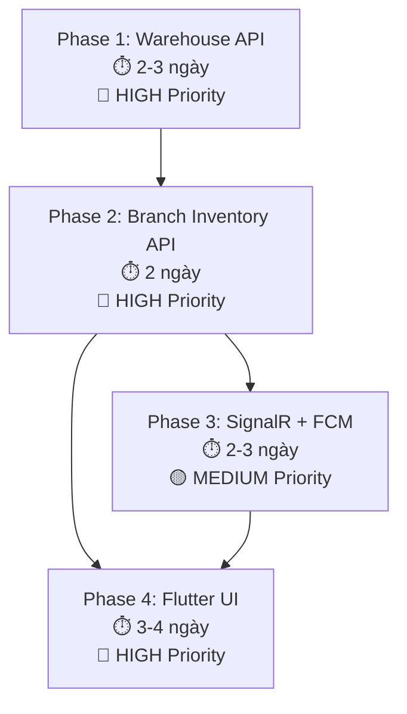

# Đánh Giá Mức Độ Sẵn Sàng & Kế Hoạch Triển Khai Theo Phases
## Dev 3 - Minh Khánh: Warehouse & Inventory Management

---

## 1. Đánh Giá Tổng Quan: ✅ ĐÃ SẴN SÀNG ĐỂ BẮT TAY VÀO CODE

Sau khi đối chiếu file [implementation_plan_dev3_no_db_change.md](file:///d:/PRM393/PRJ/convenience_store_backend/implementation_plan_dev3_no_db_change.md) với toàn bộ codebase hiện tại, kết luận: **Dự án đã có đầy đủ nền tảng (foundation) để Dev 3 bắt đầu code ngay lập tức mà KHÔNG cần chờ ai khác.**

### Các thành phần đã có sẵn (Foundation ✅)

| Thành phần | Trạng thái | Ghi chú |
|---|---|---|
| Domain Entities | ✅ Đầy đủ | `WarehouseInventory`, `BranchInventory`, `PurchaseOrder`, `PurchaseOrderDetail`, `GoodsReceipt`, `GoodsReceiptDetail`, `Notification`, `Product`, `Branch`, `Supplier`, `User` - tất cả đã có |
| Enum `PurchaseOrderStatus` | ✅ Có | `Pending`, `Received`, `Cancelled` - đúng 3 giá trị cần dùng |
| `Product` entity | ✅ Đầy đủ | Có `Unit`, `ImportUnit`, `ConversionFactor` (default=1) - sẵn sàng cho logic quy đổi đơn vị |
| `IGenericRepository<T>` | ✅ Có | Có `GetAsync(predicate)` cho composite-key entities |
| `IUnitOfWork` | ✅ Có | Có `BeginTransactionAsync()`, `CommitTransactionAsync()`, `RollbackTransactionAsync()` |
| Mẫu code tham khảo | ✅ Có | `BranchOrderService` - mẫu hoàn hảo để học cách inject repositories, dùng transaction, upsert inventory |
| `Program.cs` | ✅ Có | Đã có pattern DI registration rõ ràng, chỉ cần thêm dòng mới |
| Hubs folder | ✅ Có | `ConvenienceStore.API/Hubs/` đã tồn tại (có `.gitkeep`) |
| BackgroundJobs folder | ✅ Có | `ConvenienceStore.Infrastructure/BackgroundJobs/` đã tồn tại |

### Các thành phần CẦN TẠO MỚI (theo plan)

| Thành phần | Số lượng file | Thuộc Phase |
|---|---|---|
| DTOs (Inventory, PurchaseOrder, GoodsReceipt, Notification) | ~16 files | Phase 1 & 2 |
| Service Interfaces | 5 files | Phase 1, 2, 3 |
| Service Implementations | 5 files | Phase 1, 2, 3 |
| Constants | 1 file | Phase 2 |
| Controllers | 5 files | Phase 1, 2, 3 |
| SignalR Hub | 1 file | Phase 3 |
| FCM Service | 2 files | Phase 3 |
| Background Service | 1 file | Phase 3 |
| Flutter features (inventory, notification) | ~15 files | Phase 4 |

> [!IMPORTANT]
> **KHÔNG CẦN** tạo thêm bất kỳ Entity, Migration, hay DbSet nào. Tất cả đều dùng lại những gì đã có.

---

## 2. Kế Hoạch Triển Khai Chi Tiết Theo Phases

### ═══════════════════════════════════════
### Phase 1: Warehouse Inventory API (Backend)
### Ước tính: 2-3 ngày
### ═══════════════════════════════════════

**Mục tiêu:** Xây dựng hoàn chỉnh luồng nhập hàng từ nhà cung cấp vào Kho tổng.

#### Bước 1.1: Tạo DTOs (Ngày 1 - Buổi sáng)

Tạo folder và files:
```
ConvenienceStore.Application/DTOs/Inventory/
├── WarehouseInventoryDto.cs
└── WarehouseInventoryListDto.cs

ConvenienceStore.Application/DTOs/PurchaseOrder/
├── CreatePurchaseOrderRequest.cs
├── CreatePurchaseOrderItemDto.cs
├── PurchaseOrderDto.cs
└── PurchaseOrderItemDto.cs

ConvenienceStore.Application/DTOs/GoodsReceipt/
├── CreateGoodsReceiptRequest.cs
├── GoodsReceiptItemDto.cs
└── GoodsReceiptDto.cs
```

#### Bước 1.2: Tạo Service Interfaces (Ngày 1 - Buổi sáng)

Tạo trong `ConvenienceStore.Application/Services/Interfaces/`:
- `IWarehouseInventoryService.cs` — methods: `GetAll`, `GetByProduct`, `GetLowStock`
- `IPurchaseOrderService.cs` — methods: `Create`, `GetAll`, `GetById`, `Cancel`
- `IGoodsReceiptService.cs` — methods: `ReceiveGoods`, `GetAll`, `GetById`
- `INotificationService.cs` — methods: `CreateAuditLog` (phiên bản minimal, sẽ mở rộng ở Phase 3)

#### Bước 1.3: Implement Services (Ngày 1 buổi chiều - Ngày 2)

Tạo trong `ConvenienceStore.Application/Services/`:
- `WarehouseInventoryService.cs`
- `PurchaseOrderService.cs`
- `GoodsReceiptService.cs` ⚠️ **Phức tạp nhất** - chứa logic nhận hàng, upsert kho, quy đổi đơn vị
- `NotificationService.cs` (phiên bản minimal: chỉ tạo record vào DB)

> [!TIP]
> **Mẫu tham khảo quan trọng:** Hãy đọc kỹ [BranchOrderService.cs](file:///d:/PRM393/PRJ/convenience_store_backend/ConvenienceStore.Application/Services/BranchOrderService.cs) để học cách:
> - Inject `IGenericRepository<T>` và `IUnitOfWork`
> - Dùng `GetAsync(predicate)` cho composite-key (dòng 171-173, 191-193)
> - Dùng transaction pattern (dòng 163-227)
> - Upsert inventory (dòng 195-211)

#### Bước 1.4: Tạo Controllers (Ngày 2)

Tạo trong `ConvenienceStore.API/Controllers/`:
- `WarehouseInventoryController.cs`
- `PurchaseOrdersController.cs`
- `GoodsReceiptsController.cs`

#### Bước 1.5: Đăng ký DI trong Program.cs (Ngày 2)

Thêm vào [Program.cs](file:///d:/PRM393/PRJ/convenience_store_backend/ConvenienceStore.API/Program.cs) (sau dòng 38):
```csharp
builder.Services.AddScoped<IWarehouseInventoryService, WarehouseInventoryService>();
builder.Services.AddScoped<IPurchaseOrderService, PurchaseOrderService>();
builder.Services.AddScoped<IGoodsReceiptService, GoodsReceiptService>();
builder.Services.AddScoped<INotificationService, NotificationService>();
```

#### Bước 1.6: Build + Test API bằng Swagger (Ngày 2-3)

Kiểm tra:
- [ ] `dotnet build` thành công
- [ ] Tạo PO -> Nhận hàng -> Kiểm tra `WarehouseInventory.Quantity` tăng đúng = `QuantityReceived × ConversionFactor`
- [ ] PO status chuyển sang `Received` sau khi nhận hàng
- [ ] Nhận hàng cùng PO lần 2 -> Bị reject
- [ ] Nhận hàng > số lượng đặt -> Bị reject

---

### ═══════════════════════════════════════
### Phase 2: Branch Inventory & Stock Adjustment API (Backend)
### Ước tính: 2 ngày
### ═══════════════════════════════════════

**Mục tiêu:** Quản lý tồn kho chi nhánh + Kiểm kê kho (Stock Adjustment) với audit log.

#### Bước 2.1: Tạo DTOs bổ sung (Ngày 4 - Buổi sáng)

Thêm vào `ConvenienceStore.Application/DTOs/Inventory/`:
```
├── BranchInventoryDto.cs
├── BranchInventoryListDto.cs
├── StockAdjustmentRequest.cs
├── StockAdjustmentItemDto.cs
├── StockAdjustmentResultDto.cs
└── StockAdjustmentResultItemDto.cs
```

#### Bước 2.2: Tạo Constants (Ngày 4 - Buổi sáng)

```
ConvenienceStore.Application/Constants/AdjustmentReasons.cs
```
Chứa: `Damaged`, `Expired`, `Lost`, `Found`, `Other`

#### Bước 2.3: Implement BranchInventoryService (Ngày 4 buổi chiều - Ngày 5)

Tạo `IBranchInventoryService` và `BranchInventoryService`:
- Logic phân quyền theo JWT claims (`BranchId`, `Role`)
- `AdjustStock` logic: validate → tính Delta → update quantity → tạo Notification audit log
- Tất cả trong 1 transaction

> [!WARNING]
> **Lưu ý composite-key:** `BranchInventory` có khóa ghép `(BranchId, ProductId)`. **KHÔNG ĐƯỢC** dùng `GetByIdAsync()`. Phải dùng:
> ```csharp
> var inventory = (await _branchInventoryRepository
>     .GetAsync(bi => bi.BranchId == branchId && bi.ProductId == productId))
>     .FirstOrDefault();
> ```

#### Bước 2.4: Tạo Controller + DI (Ngày 5)

- `BranchInventoryController.cs` với endpoint nested: `/api/branches/{branchId}/inventory/...`
- Đăng ký `IBranchInventoryService` vào `Program.cs`

#### Bước 2.5: Test (Ngày 5)

- [ ] Store Manager adjust stock ở branch mình -> OK
- [ ] Store Manager adjust stock ở branch khác -> Bị reject
- [ ] Notification audit log được tạo đúng format
- [ ] Delta = 0 -> Không tạo notification

---

### ═══════════════════════════════════════
### Phase 3: Notifications, SignalR & FCM (Backend)
### Ước tính: 2-3 ngày
### ═══════════════════════════════════════

**Mục tiêu:** Hoàn thiện API Notifications + real-time alerts qua SignalR + push notification qua FCM.

#### Bước 3.1: Mở rộng NotificationService (Ngày 6)

Thêm DTOs:
```
ConvenienceStore.Application/DTOs/Notification/
├── NotificationDto.cs
└── NotificationListDto.cs
```

Mở rộng `INotificationService` và `NotificationService`:
- `CreateAndSendNotificationAsync` (gọi SignalR sau khi lưu DB)
- `GetNotificationsAsync` (phân trang)
- `GetUnreadCountAsync`
- `MarkAsReadAsync` / `MarkAllAsReadAsync`

#### Bước 3.2: Tạo NotificationsController (Ngày 6)

Endpoints: `GET /api/notifications`, `GET .../unread-count`, `PUT .../{id}/read`, `PUT .../read-all`

#### Bước 3.3: Tạo SignalR Hub (Ngày 7)

Tạo `ConvenienceStore.API/Hubs/InventoryHub.cs`:
- Route: `/hubs/inventory`
- Groups: `warehouse`, `branch-{branchId}`, `role-store-manager`, `role-warehouse-staff`
- Client events: `ReceiveNotification`, `ReceiveInventoryUpdate`, `ReceiveLowStockAlert`

Cập nhật `Program.cs`:
```csharp
builder.Services.AddSignalR();
// ...
app.MapHub<InventoryHub>("/hubs/inventory");
```

> [!IMPORTANT]
> CORS hiện tại dùng `AllowAnyOrigin()`. Khi thêm SignalR cần đổi sang `AllowCredentials()` + specify origins cụ thể, vì SignalR WebSocket không hoạt động với `AllowAnyOrigin`.

#### Bước 3.4: Tạo FCM Service (Ngày 7-8)

- `ConvenienceStore.Application/Contracts/External/IFcmService.cs`
- `ConvenienceStore.Infrastructure/ExternalServices/Fcm/FcmService.cs`
- Dùng topic-based push (không cần bảng device token)
- Cấu hình `appsettings.json` chỉ chứa `Firebase.ProjectId`

#### Bước 3.5: Tạo Background Service kiểm tra tồn kho thấp (Ngày 8)

- `ConvenienceStore.Infrastructure/BackgroundJobs/InventoryLowStockBackgroundService.cs`
- Dùng `BackgroundService` / `IHostedService` (KHÔNG dùng Hangfire)
- Chạy định kỳ mỗi 60 phút, kiểm tra `WarehouseInventory` và `BranchInventory`

Cấu hình trong `appsettings.json`:
```json
{
  "InventoryAlerts": {
    "LowStockThreshold": 10,
    "LargeAdjustmentThreshold": 20,
    "CheckIntervalMinutes": 60
  }
}
```

---

### ═══════════════════════════════════════
### Phase 4: Frontend Flutter
### Ước tính: 3-4 ngày
### ═══════════════════════════════════════

**Mục tiêu:** Xây dựng giao diện Flutter cho Warehouse Staff và Store Manager.

#### Bước 4.1: Tạo module `features/inventory/` (Ngày 9-10)

```
lib/features/inventory/
├── models/
│   ├── warehouse_inventory_model.dart
│   ├── branch_inventory_model.dart
│   └── stock_adjustment_result_model.dart
├── services/
│   └── inventory_api_service.dart
├── providers/
│   ├── warehouse_inventory_provider.dart
│   └── branch_inventory_provider.dart
├── screens/
│   ├── warehouse_inventory_screen.dart
│   ├── goods_receiving_screen.dart
│   ├── branch_inventory_screen.dart
│   └── stock_adjustment_screen.dart
└── widgets/
    ├── inventory_card.dart
    ├── low_stock_badge.dart
    └── barcode_scanner.dart
```

#### Bước 4.2: Tạo module `features/notification/` (Ngày 11)

```
lib/features/notification/
├── models/
│   └── notification_model.dart
├── services/
│   └── notification_api_service.dart
├── providers/
│   └── notification_provider.dart
├── screens/
│   └── notification_screen.dart
└── widgets/
    └── audit_log_card.dart
```

#### Bước 4.3: Tích hợp SignalR & FCM vào Flutter (Ngày 12)

- Dùng package `signalr_core` kết nối tới `/hubs/inventory`
- Dùng package `firebase_messaging` subscribe topic
- Đăng ký providers mới trong `main.dart`
- Cập nhật routing trong `app_router.dart`

---

## 3. Thứ Tự Ưu Tiên Thực Hiện



> [!TIP]
> **Lời khuyên:** Phase 4 (Flutter UI) có thể bắt đầu song song với Phase 3 nếu Phase 1 + 2 đã hoàn thành và test OK qua Swagger. Frontend chỉ cần chờ SignalR/FCM cho phần real-time notification, còn các màn hình CRUD có thể code trước.

---

## 4. Checklist Trước Khi Bắt Đầu Code

- [x] Entities đã có trong DB ✅
- [x] `IGenericRepository<T>` có `GetAsync(predicate)` ✅
- [x] `IUnitOfWork` có transaction support ✅
- [x] `PurchaseOrderStatus` enum đã có 3 giá trị ✅
- [x] `Product` có `ConversionFactor`, `Unit`, `ImportUnit` ✅
- [x] Có service mẫu để tham khảo (`BranchOrderService`) ✅
- [x] Folder structure cho Hubs, BackgroundJobs đã tồn tại ✅
- [ ] **Cần xác nhận:** Backend đang chạy được (`dotnet run`) và kết nối DB OK?
- [ ] **Cần xác nhận:** Đã có data seed cho `Product`, `Supplier`, `Branch` để test?

---

## 5. Rủi Ro Và Lưu Ý

> [!CAUTION]
> 1. **KHÔNG ĐƯỢC** tạo migration hoặc thay đổi DB schema. Mọi thứ phải dùng lại entities hiện có.
> 2. **KHÔNG ĐƯỢC** dùng `GetByIdAsync()` cho entities có composite key (`BranchInventory`, `PurchaseOrderDetail`, `GoodsReceiptDetail`).
> 3. **CORS cần sửa** khi thêm SignalR: `AllowAnyOrigin()` không tương thích với WebSocket. Cần đổi sang `WithOrigins(...)` + `AllowCredentials()`.
> 4. **Hangfire đã có sẵn** trong `Program.cs` (dòng 41-47). Background low-stock check phải dùng `IHostedService` riêng, KHÔNG dùng Hangfire (để tránh tạo thêm bảng Hangfire).
